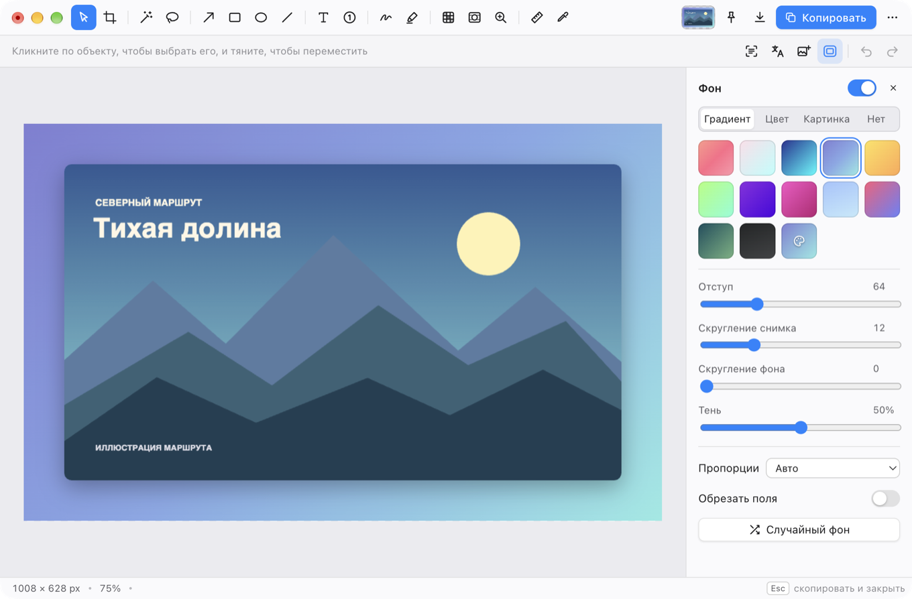
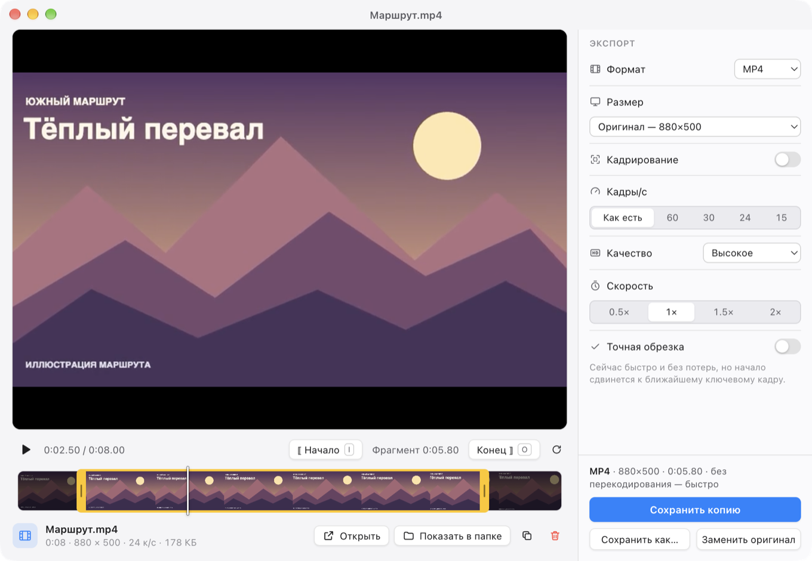

# Kadr

[Download](#download) · [Screenshot gallery](#screenshot-gallery) · [Build from source](#build-from-source)

Kadr takes screenshots, annotates images, and records the screen on macOS and Windows. Open it from the menu bar or system tray, or use keyboard shortcuts. Kadr opens images and videos from disk and has an English and Russian interface. Shottr inspired the project.


## What Kadr does

- Capture a region, a window, or a whole display. Repeat the last region or take a scrolling screenshot. Kadr can highlight sections of a window as you select a region. The color picker copies a color in the format you choose.
- Add arrows, shapes, text, numbered steps, highlights, blur, or pixelation. Crop the image, magnify an area, measure with a ruler, or use the selection tools. Remove the background or add a backdrop with a gradient, shadow, and rounded corners.
- Recognize English and Russian text and read QR codes. On macOS 26 or later, download the languages you need to use the built-in translator. On Windows, Kadr can open an online translator after you confirm.
- Save captures to the library and search by recognized text, app, or date. Pin images above other windows.
- Record a display, window, or region with microphone and system audio. The video editor opens recordings and existing files. Trim by time or frame, crop, resize, and export as MP4, WebM, MOV, MKV, or GIF.

### Screenshot gallery

These screenshots, including the editor image above, show Kadr running with sample data.

| Backdrop | Video editor |
| --- | --- |
|  |  |

| Keyboard shortcuts | Library |
| --- | --- |
|  |  |

## Download

Open [GitHub Releases](https://github.com/evgeniyov/Kadr/releases) and choose an available build under **Assets**.

| Platform | File |
| --- | --- |
| macOS, Apple Silicon (M series) | `arm64.dmg` |
| macOS, Intel | `x64.dmg` |
| Windows x64 | Install with the `.msi`, or extract the `.zip` and run `Kadr.exe` without installing. |

### First launch

On macOS, open the DMG and drag Kadr to Applications. Public macOS builds use ad hoc signing and lack Apple notarization. If your macOS version offers **Open** when you Control-click Kadr in Finder, choose it. If Gatekeeper blocks Kadr, open **System Settings**, select **Privacy & Security**, and choose **Open Anyway**. Proceed only if you downloaded the file from this project's Releases. [Apple instructions in English](https://support.apple.com/en-us/102445) · [Apple instructions in Russian](https://support.apple.com/ru-ru/102445)

To take screenshots or record the screen, grant Kadr **Screen & System Audio Recording** access in **Privacy & Security** and relaunch it. Grant microphone access to record your voice and Accessibility access to scroll automatically.

On Windows, if SmartScreen says "Windows protected your PC," check that the file came from this project's Releases. If Windows lets you continue, select **More info** and then **Run anyway**. [Microsoft guidance](https://learn.microsoft.com/windows/apps/package-and-deploy/smartscreen-reputation)

## Status

- Apple Silicon is the main development platform. The project has tested capture on multiple displays on macOS. Long recordings with audio still need hardware testing.
- The project provides a separate build for Intel Macs. It still needs full testing on an Intel Mac.
- Windows x64 support is experimental. The project provides an MSI installer and a ZIP archive. Both still need testing on Windows hardware.

## Build from source

Install Node.js 24 or later. On macOS, install Xcode and its command-line tools to build the Swift helper.

```bash
git clone https://github.com/evgeniyov/Kadr.git
cd Kadr
npm ci
npm run build:helper:mac   # macOS only
npm start
```

Run `npm test` for regression tests. Run `npm run test:electron` in a graphical session to check the interface. To build installers, run `npm run dist:mac` on macOS or `npm run dist:win` on Windows.

[Architecture](docs/ARCHITECTURE.md) · [Changelog](CHANGELOG.md)

## License

Kadr's code uses the [MIT License](LICENSE). See [Third-party notices](THIRD_PARTY_NOTICES.md) for the licenses and sources of bundled components.
