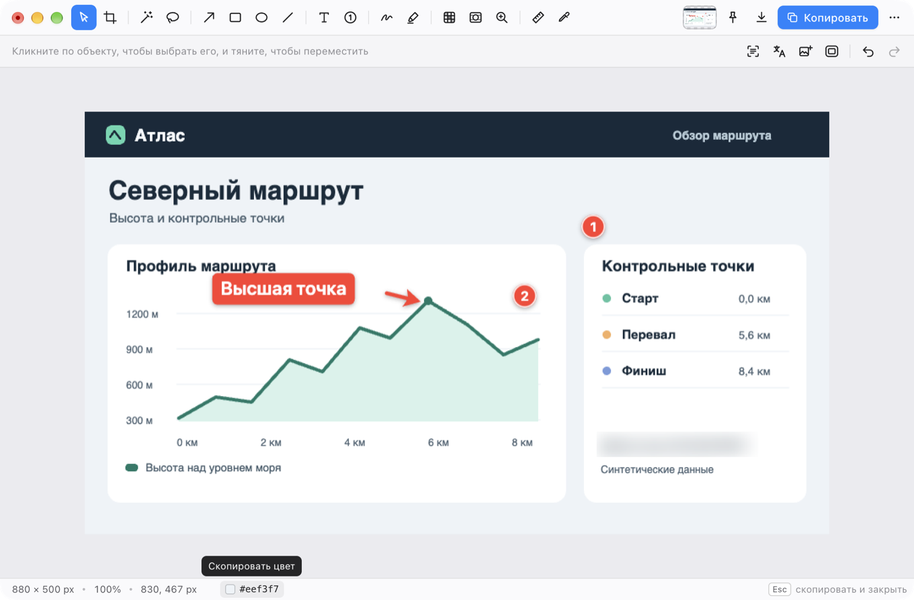
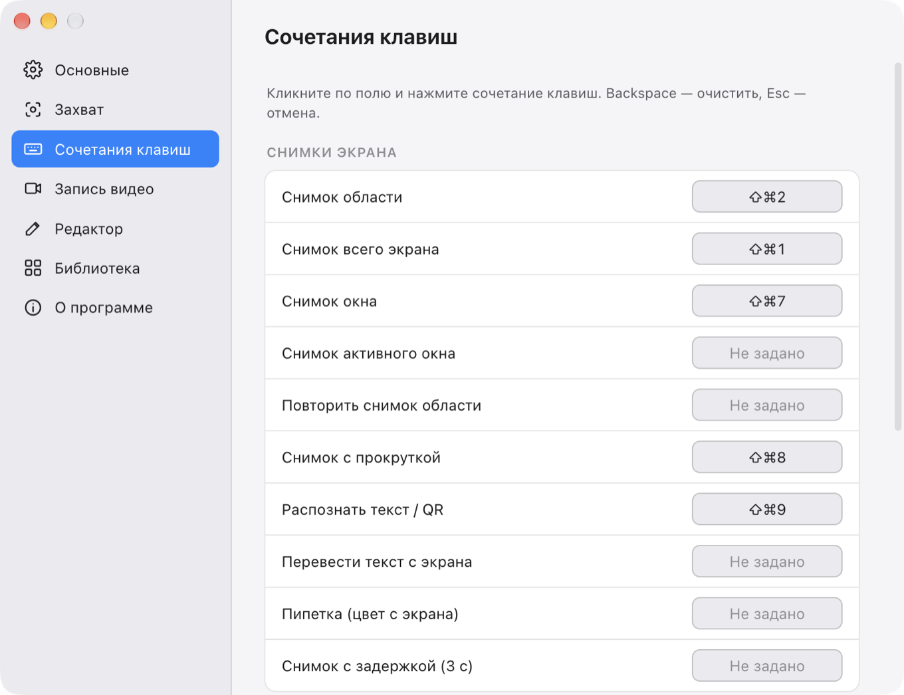
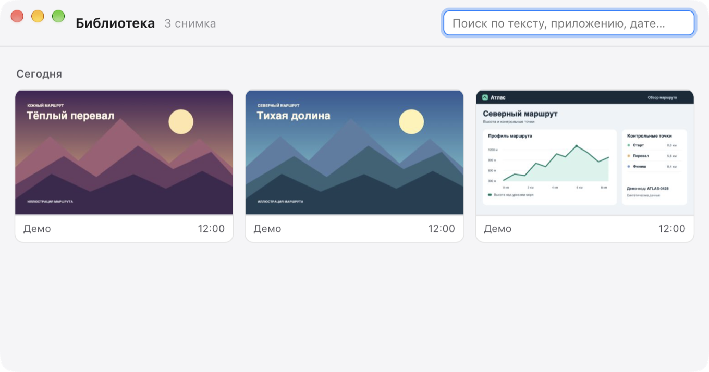

# Kadr

[English](#english) · [Скачать](#скачать) · [Исходный код и сборка](#исходный-код-и-сборка)

**Kadr** — приложение для скриншотов, аннотаций и записи экрана на macOS и Windows. Работает из строки меню или системного трея, поддерживает горячие клавиши и открывает изображения и видео с диска. Интерфейс на русском и английском. Проект вдохновлён Shottr.



## Возможности

- **Захват.** Область, окно или весь экран, повтор последней области и снимки с прокруткой. При выделении Kadr может подсвечивать блоки внутри окна. Пипетка копирует цвет в выбранном формате.
- **Аннотации.** Стрелки, фигуры, текст, нумерованные шаги, маркер, размытие и пикселизация. Есть кадрирование, лупа, линейка, выделение, удаление фона и подложки с тенью и скруглением.
- **Текст и QR.** Распознавание русского и английского текста и QR-кодов. На macOS 26+ можно переводить текст встроенным переводчиком после загрузки языков. Windows может открыть онлайн-переводчик с подтверждением.
- **Библиотека.** Сохраняет снимки и позволяет искать их по распознанному тексту, приложению и дате. Изображения можно закреплять поверх окон.
- **Запись и видео.** Запись экрана, окна или области с микрофоном и системным звуком. Видеоредактор открывает записи и свои файлы, обрезает их по времени или кадру и экспортирует в MP4, WebM, MOV, MKV или GIF.

### Галерея

| Подложка | Видеоредактор |
| --- | --- |
|  |  |

| Сочетания клавиш | Библиотека |
| --- | --- |
|  |  |

На снимках показаны окна запущенного Kadr с демонстрационными данными.

## Скачать

Откройте [GitHub Releases](https://github.com/evgeniyov/Kadr/releases) и выберите файл в разделе **Assets**, когда сборка для вашей платформы доступна.

| Платформа | Файл |
| --- | --- |
| macOS, Apple Silicon (серия M) | `arm64.dmg` |
| macOS, Intel | `x64.dmg` |
| Windows x64 | `.msi` — установщик, `.zip` — распаковать и запустить `Kadr.exe` без установки |

### Первый запуск

**macOS.** Откройте DMG и перетащите Kadr в «Программы». Публичные сборки используют самоподпись без нотаризации Apple. Для первого запуска попробуйте Finder → правый клик по **Kadr** → **Открыть**, если ваша версия macOS предлагает этот вариант. Если Gatekeeper заблокировал запуск, откройте **Системные настройки → Конфиденциальность и безопасность → Всё равно открыть**. Продолжайте, если скачали файл из Releases этого проекта. [Инструкция Apple](https://support.apple.com/ru-ru/102445)

Для снимков и видео разрешите Kadr **«Запись экрана и системного звука»** в разделе «Конфиденциальность и безопасность» и перезапустите приложение. Микрофон нужен для записи голоса, а универсальный доступ — для автоматической прокрутки.

**Windows.** Если SmartScreen показывает «Система Windows защитила ваш компьютер», проверьте, что файл скачан из Releases этого проекта. Если Windows предлагает продолжить, выберите **Подробнее → Выполнить в любом случае**. [Справка Microsoft](https://learn.microsoft.com/windows/apps/package-and-deploy/smartscreen-reputation)

## Статус

- **macOS на Apple Silicon** — основная платформа разработки. Захват на нескольких дисплеях проверялся на macOS. Длительная запись со звуком требует отдельной проверки на реальном оборудовании.
- **macOS на Intel** — предусмотрена отдельная сборка. Полноценная проверка работы на Intel Mac пока не проведена.
- **Windows x64** — экспериментальная поддержка. Предусмотрены установщик MSI и ZIP-архив. Работа на реальной Windows пока не подтверждена.

## Исходный код и сборка

Понадобится Node.js 24 или новее. На macOS установите Xcode с инструментами командной строки для сборки помощника на Swift.

```bash
git clone https://github.com/evgeniyov/Kadr.git
cd Kadr
npm ci
npm run build:helper:mac   # только macOS
npm start
```

`npm test` запускает регрессионные проверки, `npm run test:electron` проверяет интерфейс в графическом сеансе. Для сборки установщиков используйте `npm run dist:mac` на macOS или `npm run dist:win` на Windows.

[Архитектура](docs/ARCHITECTURE.md) · [История изменений](CHANGELOG.md)

## Лицензия

Код Kadr распространяется по [лицензии MIT](LICENSE). Лицензии и источники сторонних компонентов перечислены в [Third-Party Notices](THIRD_PARTY_NOTICES.md).

## English

**Kadr** is a menu-bar and system-tray app for screenshots, image annotation and screen recording on macOS and Windows. Its interface is available in English and Russian.

- Capture a region, window or whole display, take scrolling screenshots and pick colors from the screen.
- Edit captures and existing images with arrows, text, numbered steps, blur, pixelation, crop, background removal and gradient backdrops.
- Recognize English and Russian text and QR codes, search the capture library and pin images above other windows.
- Record a display, window or region with microphone and system audio. Open recordings or existing videos to trim, crop, resize and export them.

The [screenshot gallery](#галерея) shows the annotation editor, backdrop controls, video editor, shortcut settings and library with sample content.

### Download and first launch

Pick an available build from [GitHub Releases](https://github.com/evgeniyov/Kadr/releases). On macOS use the `arm64.dmg` for Apple Silicon or the `x64.dmg` for Intel. On Windows x64 use the `.msi` installer, or unpack the `.zip` and run `Kadr.exe`.

- **macOS.** Drag Kadr from the DMG to Applications. Public builds use self-signing without Apple notarization. In Finder, Control-click Kadr and choose **Open** if your macOS version offers that option. If Gatekeeper blocks the launch, go to **System Settings → Privacy & Security → Open Anyway** after verifying the download source. To take screenshots or record, grant **Screen & System Audio Recording** access and relaunch Kadr. Automatic scrolling requires Accessibility access. [Apple instructions](https://support.apple.com/en-us/102445)
- **Windows.** If SmartScreen says “Windows protected your PC,” verify you downloaded the file from this project's Releases. If the prompt allows it, choose **More info → Run anyway**. [Microsoft guidance](https://learn.microsoft.com/windows/apps/package-and-deploy/smartscreen-reputation)

### Platform status and source builds

Apple Silicon is the primary development platform. Long recordings with audio still need hardware testing. A separate Intel build is configured and full testing on an Intel Mac is pending. Windows x64 support is experimental and awaits testing on real Windows hardware.

Install Node.js 24 or later. On macOS, install Xcode and its command-line tools for the Swift helper.

```bash
git clone https://github.com/evgeniyov/Kadr.git
cd Kadr
npm ci
npm run build:helper:mac   # macOS only
npm start
```

Run `npm test` for regression tests and `npm run test:electron` for GUI smoke tests. Build distributables with `npm run dist:mac` on macOS or `npm run dist:win` on Windows.

Kadr's code is [MIT-licensed](LICENSE). See [Third-Party Notices](THIRD_PARTY_NOTICES.md) for bundled components and their licenses. Developer documentation is in [Architecture](docs/ARCHITECTURE.md), and release notes are in the [changelog](CHANGELOG.md).
